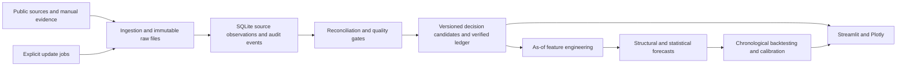

# Lebanon gasoline forecasting architecture

## Part 8 operational layer

The native per-user LaunchAgent invokes `automation/cli.py`. `schedule.py` evaluates Beirut watch windows and normal cadence. `runner.py` serializes refreshes, bounds each source subprocess, honors denial cooldowns, reconciles/export observations, matches reviewed outcomes, records forecast checks, updates monitoring/reports and creates backups. `state.py` owns the append-only operations journal and atomic report updates. `maintenance.py` checks SQLite, source/model evidence, conversion arithmetic and backups. `monitoring.py` separates prospective metrics from research, and requests review rather than retraining. `forecast.py` records current abstentions using the Part 6 gate and immutable ledger. Numerical production issuance has not been approved or implemented by this operational adapter.

The dashboard's manual refresh controls share this runner. Database reads remain cached and read-only. Current forecast display also requires a fresh timestamp and respects later abstentions. No external API failure substitutes invented market values. See [operations](operations.md) for actual installed scheduling, thresholds, recovery and commands.

Python 3.11+; Parts 2–5 were run on native Apple Silicon CPython 3.13.12. SQLite and the standard `zoneinfo` database keep the first deployment local and lightweight. The local dashboard connects the research, data, structural and validation modules.

## Boundaries and layout

| Path | Responsibility |
| --- | --- |
| `research/` | Sourced methodology, assumptions, unresolved issues and preserved research evidence |
| `src/lebanon_fuel/ingestion/` | Public page/XLSX/CSV adapters; source access and parse provenance |
| `src/lebanon_fuel/storage/` | SQLite schema, observations, revision history and reconciliation |
| `src/lebanon_fuel/market/` | Public market collectors, separate SQLite market tables, revisions, source catalogue and reports |
| `src/lebanon_fuel/features/` | Trailing availability-aware market features, provenance and staleness controls |
| `src/lebanon_fuel/forecasting/` | Event/calendar labels, baseline/proxy/econometric/ML models, chronological development fits, calibration, saved models and reports |
| `src/lebanon_fuel/news/` | Optional public EIA collection, immutable text versions, channel tags, availability gates and paired news ablation |
| `src/lebanon_fuel/validation/` | Source quality, strict eligibility/walk-forward framework, separate temporal research challenge, independent metric equations, stress/policy gates and immutable forecast accountability |
| `src/lebanon_fuel/dashboard/` | Local Streamlit and Plotly terminal, read-only queries and on-demand collection |
| `src/lebanon_fuel/automation/` | Future explicit local update orchestration; no live scheduler registered |
| `config/`, `data/raw/`, `data/exports/`, `reports/`, `Tests/fuel/` | Configuration, immutable captures, CSV exports, quality reports and deterministic tests |

## Storage and timing contracts

Store immutable source observations separately from reconciled per-date candidates. Keep raw bytes in content-addressed files plus literal row JSON, source publication date/time if supplied, effective date only when established, source-labelled date otherwise, UTC retrieval timestamp and IANA source timezone. Date-only labels never become invented midnight publication timestamps. All date comparisons/rendering use Asia/Beirut; preserve original offsets. Use integer LBP prices, explicit 20 L units and nonzero positive validation.

Source priority: original official decision > government archive > IPT > independent supplementary archive. Priority does not resolve contradictory valid evidence silently: contested values enter quarantine. Corrections append observations and candidate revisions; they do not erase prior evidence. A daily imputed panel is not an official decision ledger. Stored changes use the previous eligible verified record and disclose that basis; they are not certified changes from the immediately preceding official decision. The latter remains unknown where predecessor evidence is incomplete.

Future forecast runs must reference a frozen dataset revision, origin in UTC/Beirut, code/config version, known-at feature snapshot and model artifact. SQL/feature joins enforce known-at <= origin. An effective date backdated by a later revision cannot leak into an earlier run. Regime parameters also carry valid-time and knowledge-time intervals.

## Operational choices

Core collection uses httpx, BeautifulSoup, openpyxl, SQLite and explicit bounded HTTP timeouts/rate limits. Batch history prefers one public export rather than repetitive date scraping. Browser automation is a fallback for controls unavailable to ordinary HTTP and is never used to bypass denial. Manual CSV import has the same validation/audit path. A failed source produces a visible failed collection run, not fabricated freshness.

Research dependencies (pandas/NumPy/scikit-learn/statsmodels), ML (LightGBM/CatBoost) and dashboard (Streamlit/Plotly) are optional dependency groups. CPU is the initial execution mode. [LightGBM's installation guide](https://lightgbm.readthedocs.io/en/stable/Installation-Guide.html) documents macOS OpenMP needs; [CatBoost installation](https://catboost.ai/docs/en/concepts/python-installation) requires 64-bit CPython (rolling docs inspected 2026-11-10). Check native wheels and lock resolved versions on the target interpreter before training. Broad dependency bounds are initial configuration, not a tested lockfile.

Part 3 adds the market ingestion/storage branch and trailing feature engineering. Market observations join to Lebanese ledger revisions through explicit timestamp snapshots and the exported alignment manifest; no market value is written as a Lebanese official decision. See `market_data.md` for source clocks, normalization, historical-vintage rules, and the strict versus research distinction. Matplotlib exports static research charts. The Part 7 dashboard uses Streamlit and Plotly. `requirements-market-lock.txt` pins the executed native data/chart/test environment. Parts 4 and 5 add separate research model branches.

## Part 4 structural pricing and research

`structural/engine.py` implements Decimal unit/cost/VAT accounting with explicit evidence and validity intervals; it has no default current tariff, FX or rounding schedule. `structural/annexes.py` checks hash-bound original transcriptions. `structural/research.py` creates provenance-rich event-pair features and chronological proxy comparisons under a frozen protocol; its estimates are excluded from live forecasts because original information-time evidence is absent. `structural/reporting.py` produces metrics, error analysis and static figures; `structural/cli.py` exposes `fuel-structure`.

No inferred parameter is written into official observations. Same-document arithmetic, retrospective estimates and illustrative future-input scenarios have separate artifacts and explicit status labels. The strict availability gate remains in the market store. See `structural_model.md` for commands, engine input contracts, reproducibility and outstanding operational requirements.

## Part 5 quantitative development

`forecasting/data.py` constructs eight direct targets, explicit maturity times and past-only features under labelled retrospective availability assumptions. `models.py` fits A–G and adapts the Part 4 engine; missing official inputs cause abstention. `uncertainty.py` estimates prior-fold weights for H, empirical intervals and separate exact-sign probabilities. `pipeline.py` purges labels, freezes fit evidence, saves/reloads sixteen horizon/regime bundles and emits historical previews plus current-date abstentions. `reporting.py` exposes common-origin scores, calibration failures and coverage; `cli.py` provides `fuel-forecast`.

The news branch shares raw capture provenance while keeping immutable text versions in separate tables. It never writes narrative predictions into commodity observations. News counts are null when prospective collection coverage is absent; no historic incremental skill has been established. Core models have no network or paid language-model dependency.

Current artifacts live under `data/models/part5/`, `data/exports/forecasting/` and `reports/forecasting/`. Model files reference the exact design, features, code and package versions. This stage introduces research forecasts only; independent validation, current-regime approval and operational forecasting remain gated. See `quantitative_forecasting.md` for targets, model cards, limitations and commands.

## Part 6 model risk and accountability

`validation/backtest.py` separates strict knowledge-time eligibility from explicitly retrospective research construction. `runner.py` preserves Part 5 models, fits prespecified research blocks and adds strong last-change/Brent baselines. `metrics.py` independently recomputes price/change, direction, no-change, probability and interval metrics with counts, common origins and dependent bootstrap diagnostics. `stress.py` separates observed shock subsets from synthetic input checks. `policy.py` supplies an operational abstention guard.

`validation/ledger.py` owns `data/forecast_ledger.sqlite`, separate from source observations. Model/input hashes and true creation timestamps bind immutable forecasts to their information set. Immutable outcome versions and evaluations preserve subsequent corrections without altering forecasts. `settlement.py` requires original-document review, clocks and complete-sequence evidence before official matching. `cli.py` exposes `fuel-validate`.

Strict historical and fresh final sample sizes are zero. Current source/policy and calibration gaps cause production rejection. Retrospective results and prospective abstentions are recorded honestly; no historical creation time is fabricated. All three requested production model selections remain null in `reports/model_validation/production_selection.json`. See `model_validation.md` for reproduction, ledger schema and settlement contracts. 

## Part 7 local terminal

The Streamlit entry point is `src/lebanon_fuel/dashboard/app.py`. Read-only database queries provide source history, observations and ledger forecasts. Cache keys include database and WAL file versions. On-demand refresh invokes the existing collectors. The scenario adapter builds requests for the existing structural cost engine. The forecast panel reads the production decision and the prospective ledger, and displays the current abstention. See [dashboard launch instructions](dashboard.md).
