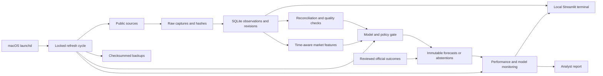

# Lebanon gasoline 95 forecasting system — final project report

**Status at 11 November 2026, Asia/Beirut:** the local data, research, dashboard and automation system is working. The project has **no approved production forecasting model**, so it deliberately withholds current price predictions and probabilities. Completion of engineering does not imply completion of the financial validation requirements.

The target is Lebanon's official gasoline 95 consumer price, **LBP per 20 liters**, with the change at the next official pricing decision as the primary forecast target. This report draws on actual stored observations, preserved research forecasts, verification outputs and a real launchd refresh. It contains no simulated market history or invented accuracy.

## 1. Delivery across the eight stages

| Stage | Completed functionality | Unresolved boundary |
| --- | --- | --- |
| 1 Research and architecture | Sourced mechanism research, evidence register, source assessment and modular Python project | Complete current formula and current legal parameters remain unknown |
| 2 Lebanese prices | Actual IPT export/ministry/Taqtek collection, immutable observations, reconciliation, CSVs and quality controls | Complete decision sequence, publication clocks and many effective dates missing |
| 3 International markets | EIA, EC and Federal Reserve histories, normalized units, dated captures, trailing features and charts | Licensed Mediterranean assessments/freight and original historical vintages missing |
| 4 Structural model | Decimal cost engine, explicit component/tax assumptions, three annex reconciliations and retrospective transmission models | Exact current formula reconstruction unavailable |
| 5 Forecast development | Eight horizons, baselines, regression, SARIMAX where supported, LightGBM, CatBoost, hybrid/ensemble, saved bundles | Models are research candidates; some combinations abstain for inadequate evidence |
| 6 Independent challenge | Chronological validation framework, comparative metrics, stress checks, permanent ledger and explicit rejection | Zero strict historical/fresh holdout evidence; calibration defects remain |
| 7 Dashboard | Running Streamlit/Plotly terminal, seven views, historical charts, scenarios, performance and analyst commentary | Current numeric forecast panels correctly remain unavailable |
| 8 Operations and final audit | Installed launchd job, manual refresh, monitoring, reports, backups, integrity checks and defect fixes | Numerical production issuer and model approval require a future reviewed deployment |

The five project-scoped skills remain under `.agents/skills/` for evidence research, forecasting, ingestion, source investigation and model audit.

## 2. System architecture



Source data, forecasts and operations have separate SQLite databases. Data collection, features, models, validation, dashboard and automation remain separate Python modules. The dashboard uses existing logic and read-only queries. The scheduled cycle never trains models or edits production approval. Architecture details are in [docs/architecture.md](../docs/architecture.md).

## 3. Data sources and access

| Source | Actual access and role | Qualification |
| --- | --- | --- |
| [IPT](https://www.iptgroup.com.lb/ipt/en/our-stations/fuel-prices) | Public form-driven XLSX historical export, successfully refreshed 11 Nov 2026 | Supplier observations, not original ministry decisions; live page has no trustworthy original publication clock |
| [MOEW archive](https://energyandwater.gov.lb/ar/prices) | Verified public search structure and available original PDFs; successful rolling refresh 11 Nov 2026 | Sparse archive, conflicting cells, date-only rows; current clock/completeness unknown |
| [Taqtek](https://taqteklb.com/en/fuel/) | Public HTML history, successful refresh 11 Nov 2026 | Supplementary archive with ministry lineage; not independent official authentication |
| [EIA](https://www.eia.gov/dnav/pet/hist/RBRTED.htm) | Public XLS histories for Brent, NYH gasoline, US inventories/utilization | Brent is crude; US gasoline is a product/geographic proxy |
| [European Commission](https://energy.ec.europa.eu/data-and-analysis/weekly-oil-bulletin_en) | Public history workbook; current refresh succeeded after an earlier recorded 429 | Italy/Greece tax-excluded consumer gasoline prices are retail proxies |
| [Federal Reserve H.10](https://www.federalreserve.gov/releases/h10/hist/dat00_eu.htm) | Public original XML, successfully refreshed | USD per EUR, not USD/LBP |
| Original MOEW annex | Reviewed 29 May 2025 customer USD-payment rate | One dated payment-conversion observation, not a continuous pricing-FX history |

Access outcomes above are **observed retrieval facts**, timestamped in the databases. They do not authenticate every source value. Per-observation original publication instants in the collected price/market histories are unavailable. FRED is not used in the live collection path because of the earlier source-policy finding. No paid Platts, ICE or freight history was obtained or replaced with a falsely labeled proxy. Source-specific URLs, publication-date limits, units and licensing findings are in [the international source register](../research/international_market_sources.md).

## 4. Historical coverage and actual latest observations

The domestic database contains 3,169 immutable source observations and 1,370 reconciled candidate source dates. These are not 1,370 certified consecutive official decisions. The archive exposes 667 distinct year/decision-number identifiers; its true total historical decision count is unknown. There are 806 archive-corroborated dates, three original-document verified dates, 42 quarantined conflict dates and 162 long-gap candidates. There are 3,169 missing original publication clocks and 3,166 unknown effective dates.

| Domestic measure | Observed result |
| --- | --- |
| IPT unique valid dates | 1,307, from 2008-01-02 through 2026-11-10 |
| Earliest corroborated/document-reviewed date | 2010-10-27, 33,300 LBP/20 L |
| Latest archive-corroborated price | 2026-10-02, 2,837,000 LBP/20 L; effective time unknown |
| Latest original-document reviewed price | 2025-05-29, 1,489,000 LBP/20 L |
| Latest supplier-only observation | 2026-11-10, 2,445,000 LBP/20 L |

The old corroborated price must not be called today's official price. Changes between verified-tier records are not necessarily changes between consecutive official decisions. See [data quality](data_quality.md) and [historical export](../data/exports/gasoline_95_history.csv).

The market database has 33,845 immutable observations, including 283 invalid/missing values preserved for audit. Valid dated coverage is shown below.

| Series | Valid unique dates | Earliest | Latest | Last normalized observation |
| --- | ---: | --- | --- | --- |
| Brent spot | 9,122 | 1987-05-20 | 2026-11-03 | 107.03 USD/bbl |
| NYH regular gasoline | 9,171 | 1986-06-02 | 2026-11-03 | 114.576 USD/bbl |
| US gasoline stocks | 1,922 | 1990-01-05 | 2026-10-30 | 208.958 million bbl |
| US crude stocks, excluding SPR | 2,301 | 1982-08-20 | 2026-10-30 | 409.76 million bbl |
| US refinery utilization | 1,879 | 1990-11-02 | 2026-10-30 | 94.5% |
| USD/EUR | 6,984 | 1999-01-04 | 2026-11-06 | 1.1154 |
| Italy gasoline excluding tax | 1,091 | 2005-01-03 | 2026-11-09 | 0.962698 EUR/L |
| Greece gasoline excluding tax | 1,091 | 2005-01-03 | 2026-11-09 | 0.931434 EUR/L |
| MOEW customer-payment FX | 1 | 2025-05-29 | 2025-05-29 | 89,700 LBP/USD, stale |

These are stored source observations, not live executable market quotations. No original per-row publication clock or original historical vintage has been established. [Market coverage](market_coverage.md) records 39 long-gap candidates and 2,653 unclassified calendar candidates; weekends/holidays must not be called missing sessions without the appropriate calendars.

## 5. Verified pricing mechanism and unresolved parameters

Historical primary evidence confirms refined-product cost inputs, currency conversion and domestic charges. A [DGO explanation published 23 February 2021](https://energyandwater.gov.lb/ar/details/100628/المديرية-العامة-للنفط-توضح-ال-لي-ـة-المعتمدة-أسبوعيا-لتحديد-أسعار-مبيع-المحروقات) described weekly Platts averages and the subsidy arrangement then. It does not establish today's window or FX weights. The [29 May 2025 decision and annex](https://energyandwater.gov.lb/mediafiles/prices/1-2025-05-29.pdf) supplies a verified dated component snapshot. Original web publication clocks are unknown. A tender's shipment-centered quotation period is not proof of the retail calculation period.

The implemented accounting form is:

`LBP/20 L = [imported goods LBP/kL + domestic charges LBP/kL + VAT on the specified taxable base] / 50`, followed only by an explicitly declared rounding hypothesis.

When benchmark-derived goods are used, explicit USD/kL product, freight and other import costs are converted using the supplied LBP/USD rate. CIF freight cannot be added twice. Every parameter carries validity, evidence and status. Three historical annexes reconcile within 3.30 LBP/20 L before rounding. This is accounting reconciliation using the same document, not predictive accuracy. Current benchmark symbol, averaging/cutoff window, component FX, tax bases, margins, freight and official rounding are unresolved. See [structural equation](../research/structural_pricing_equation.md) and [verified assumptions](../research/verified_assumptions.md).

## 6. Forecast methodology

Separate direct targets cover the next one, two and four recorded decisions and 1, 3, 7, 14 and 30 calendar days. Calendar prevailing-price targets are distinguished from announcement targets. Research assumptions about archive coverage and availability are explicit. Chronological folds purge immature labels; transformations, inner tuning, ensemble weights and calibration use earlier eligible data.

Available families include no change, last change, historical mean, positive Brent/product transmission proxies, regularized distributed-lag regression, SARIMAX where adequate, LightGBM, CatBoost, hybrid and horizon-specific ensembles. Sixteen Part 5 horizon/regime bundles are saved. The full official structural adapter abstains without dated inputs. Optional timestamped news classification remains research-only, with no measured historical incremental skill and no paid LLM dependency. Current refreshes do not fit or replace any model.

## 7. Production model selection

**Selected production model: none.** The next-decision, seven-day and thirty-day selections all remain rejected in [production_selection.json](model_validation/production_selection.json). The strict historical evaluation admits zero forecasts, and no fresh final-holdout outcome supports promotion. Current policy/target timing is unresolved. The operating system records eight-horizon checks as abstentions. Future numerical issuance requires a reviewed issuer and immutable approved model registration in addition to evidence-backed validation.

## 8. Historical prediction accuracy and baseline comparison

The following are measured on common origins in **exposed, latest-vintage retrospective challenges**. They are not verified real-time performance or selected production winners. All errors are LBP/20 L.

| Regime / horizon | Descriptive lowest-MAE model | Cases / distinct base decisions | MAE | Direction accuracy | No-change MAE |
| --- | --- | --- | ---: | ---: | ---: |
| 2018–19 / next decision | Last-change baseline | 85 / 85 | 150.59 | 72.94% | 291.76 |
| 2025 pre-fiscal / next decision | Last-change baseline | 15 / 15 | 11,066.67 | 86.67% | 15,866.67 |
| 2018–19 / 7 days | Last-change baseline | 588 / 84 | 154.42 | 72.11% | 289.80 |
| 2025 pre-fiscal / 7 days | Hybrid | 46 / 11 | 23,337.51 | 54.35% | 27,304.35 |
| 2018–19 / 30 days | Ridge | 565 / 81 | 842.46 | 66.19% | 1,062.65 |
| 2025 pre-fiscal / 30 days | Historical mean | 9 / 2 | 34,763.07 | 100% | 58,666.67 |

The recent 30-day directional fraction rests on only two base decisions and does not establish reliability. The last-change baseline beats advanced models for the primary target in both comparisons. Advanced next-decision model differences against that baseline are small or unfavorable, and most exploratory block intervals do not support meaningful gains. Historical regimes have very different price scales. Full metrics, bias, stress subsets and sample counts are in [the validation report](model_validation_report.md). No current live error or direction percentage is available.

## 9. Probability and interval calibration

The candidate nominal interval level was 90%. Older three-day coverage was approximately 56% on 599 cases; recent three-day coverage approximately 51% on 65. Other intervals over-cover, have zero width or lack sufficient samples. The audit found deterministic residual thinning overrepresented unchanged prices. Previously scored intervals remain preserved; no repair was tuned on those outcomes to erase failures. The shared directional classifier has descriptive reliability/Brier analyses, not a production calibration certificate. No current 95% interval or confidence percentage is issued. See [probability calibration](probability_calibration_analysis.md).

## 10. Current forecast and market explanation

**Current numerical forecast, direction probabilities, calibrated interval and next official announcement time are unavailable.** The latest operational snapshot retains real market values, source IDs and gate reasons. Refined gasoline, applicable FX, freight, domestic taxes and policy changes are relevant economic channels; their current contribution to the next adjustment cannot be quantified with the evidence in hand. The last stored NYH-minus-Brent quote spread is a cross-region gross spread, not a verified refinery margin. [Latest analyst commentary](latest_analyst_report.md) is evidence-based and generated without an LLM.

The scenario simulator works through the existing structural engine using explicit product/Brent-spread, FX, freight and tax assumptions. Its results are hypothetical conditional calculations and never presented as probabilistic forecasts or actual prices.

## 11. Automation, monitoring and accountability

The installed per-user LaunchAgent runs independently of Codex. Default collection is six-hourly, with hourly weekday morning watch windows and per-source limits. Dates use Asia/Beirut; UTC capture clocks are preserved. Source failures, access-denial cooldowns, conflicts, stale data and missing official clocks are visible. Reviewed outcome manifests allow correction-aware automatic matching without changing saved forecasts. No unreviewed supplier observation can settle an official target.

The actual native refresh on 11 November 2026 successfully collected all six sources. It parsed 1,312 IPT rows, five rolling-window ministry rows, 914 Taqtek rows, 24,395 EIA rows, 2,184 EC rows and 7,265 Fed rows. It added one ministry source record and two EC observations. These counts are observed, not estimated sample sizes. A subsequent native cycle honored cooldowns and refreshed all local reports. See [the audit](production_audit.md) for run identifiers and timings.

Monitoring reports prospective error, bias, direction, Brier scores, reliability bins and interval coverage/width only when verified actuals exist. Review rules require distinct outcome counts and never auto-promote models. The ledger currently preserves 44,928 issued retrospective research forecasts/evaluations and 32 prospective abstentions. There are zero issued production numerical forecasts and zero live scored numerical forecasts. These counts are a dated audit snapshot and will increase with later checks.

## 12. Verification, reliability and security

The complete fuel-project automated suite passed **141 tests in 29.29 seconds**. All three artifact-reproduction audits and the dependency-compatibility check also passed. Actual commands, counts and durations are saved in [final_verification.json](operations/final_verification.json). The project integrity audit verifies all three SQLite files, raw captures, normalized market conversions, model hashes, snapshots, stored errors and the forecast hash chain. Confirmed ledger concurrency, future-settlement, forecast-freshness and abstention-contract defects were corrected with regression tests. The browser displayed the current scheduled-cycle status and alerts in the running terminal. The unrelated Swift application's tests are outside this fuel-project audit.

Backups contain online database copies and an archive of code, configuration, raw evidence, models, reports and exports, with checksums. A fresh-directory recovery check is recorded in [backup_restore_check.json](operations/backup_restore_check.json). The local dashboard binds to 127.0.0.1. No paid API, remote model execution, internet publishing or automatic model replacement is required.

## 13. Run the application

```sh
cd /Users/andrew/MyApp_macOS
.venv/bin/python -m streamlit run src/lebanon_fuel/dashboard/app.py --server.address 127.0.0.1 --server.port 8501
```

Open <http://127.0.0.1:8501>. The scheduler remains active when the dashboard or Codex closes, while the user is logged in and the Mac can run jobs.

## 14. Maintain the application

```sh
cd /Users/andrew/MyApp_macOS
.venv/bin/python -m lebanon_fuel.automation.cli run
.venv/bin/python -m lebanon_fuel.automation.cli status
.venv/bin/python -m lebanon_fuel.automation.cli audit
.venv/bin/python scripts/verify_production.py
.venv/bin/python -m lebanon_fuel.automation.cli backup
```

Edit `config/automation.toml` for cadence and thresholds. Run `install` to reload a changed native poll interval, `kick` to request a native refresh, and `uninstall` to stop/remove this project's job. Copy complete backups off-device. Review source denials, original official documents and current legal parameters. Do not modify frozen historical predictions, use exposed challenge results as a fresh holdout, or enable production merely by changing flags. [The operations guide](../docs/operations.md) provides exact installation, verification, scheduling, settlement, dependency and recovery instructions.

## 15. Highest-value improvements and unfinished work

| Priority | Improvement | Expected value and acceptance evidence |
| --- | --- | --- |
| 1 | Obtain original current ministry decisions, complete announcement/effective clocks and current legal component schedule | Establish the actual target and regime; reconcile originals with independent source records |
| 2 | Secure authorized Mediterranean gasoline assessments and documented cutoff/averaging rules | Reduce product/region basis risk and reconstruct benchmark inputs; assess incremental value on fresh time-valid data |
| 3 | Resolve conflicting/missing domestic history and collect prospective vintages | Increase trustworthy coverage without inventing dates; maintain original capture evidence |
| 4 | Verify government calculation windows, FX treatment and freight/tax bases | Replace estimated relationships with evidenced parameters; use nested chronological estimation only for remaining unknowns |
| 5 | Repair calendar calibration on a new development sample and predeclare a fresh prospective evaluation | Correct residual-selection bias; report effective sample size, coverage, width and probability reliability |
| 6 | Continue dated policy review and obtain a separate model-risk sign-off | Detect regime changes and challenge promotion independently |

No numerical improvement magnitude is claimed for these proposed investments. Another complex model is lower priority than these evidence gaps. Production accuracy, current calibrated uncertainty, the exact current formula, complete legal surveillance and a numerical production issuer remain unfinished. The operational platform is ready to collect the evidence needed for that work while continuing to abstain honestly.

## 16. Audit remediation update (14 November 2026)

This section updates the 11 November 2026 snapshot above following an independent code and data audit:

* **Atomic live forecast batches:** `ForecastLedger.issue_batch()` and `automation/forecast.py` commit all eight horizons atomically in one `BEGIN IMMEDIATE` transaction (300-second batch origin window), preventing partial-horizon runs.
* **Unbiased holdout evaluation & Tier 1 gating:** `validation/runner.py` prevents sparse baselines from shrinking common-origin sets, enforces `unique_base_decisions >= 20` on Tier 1 approval, and stores `all_origin_performance`; `dashboard/analyst.py` surfaces both all-origin and common-origin metrics.
* **Official PDF & FX coverage:** Decision #245 (`2023-05-12`, `1,635,000 LBP/20 L`, `94,500 LBP/USD`) is now ingested into `lebanon_fuel.sqlite` (`4` original-document verified prices, `2` `lbp_payment_fx` observations).
* **OVX provenance & refreshed snapshots:** FRED `OVXCLS` collections now use `source_id='market_fred_ovx'`, and `reports/model_validation/strict_availability.json` reflects the current database (`3,175` domestic observations, `38,773` market observations, `0` strict historical forecasts). Production approval remains withheld.
